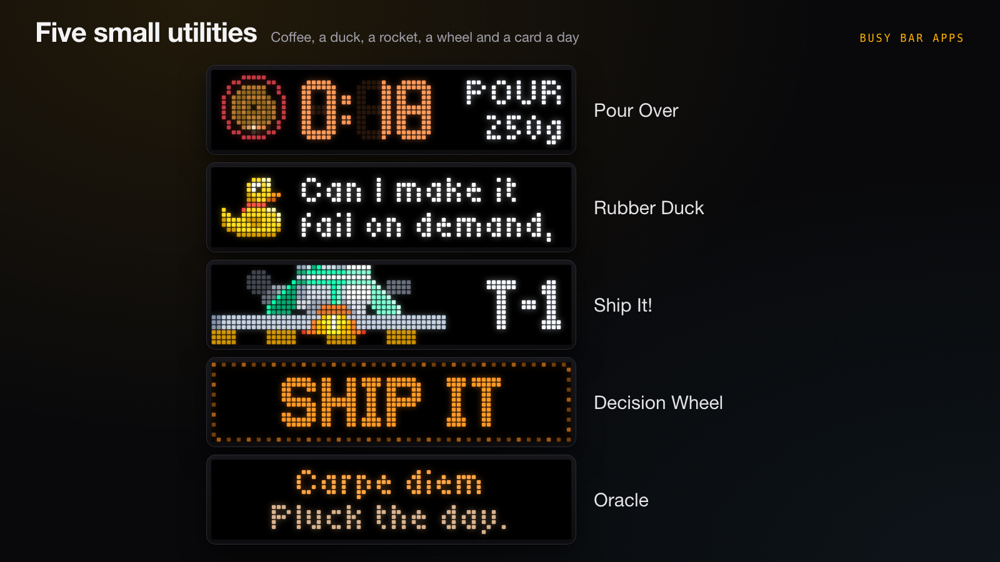

# BUSY Bar Apps

Five small apps for the BUSY Bar. Each app can be built on its own.



| App | What it does |
| --- | --- |
| [Pour Over](pourover/README.md) | A V60 and Kalita Wave brew timer with animated pour guides |
| [Rubber Duck](duck/README.md) | Questions for when you and your coding agents get stuck |
| [Ship It!](shipit/README.md) | A miniature rocket launch to celebrate finished work |
| [Decision Wheel](wheel/README.md) | A spinning reel for small choices and games with friends |
| [Oracle](oracle/README.md) | One card a day for a change of perspective |

## Build an app

With Node.js 24, run these commands in the app’s folder.

```sh
npm ci
npm run typecheck
npm run build
```

The build writes an installable package to the app’s `dist/` directory.

## License

The apps’ original work is licensed under [GPL-3.0-only](LICENSE). See [NOTICE.md](NOTICE.md) for credits.
