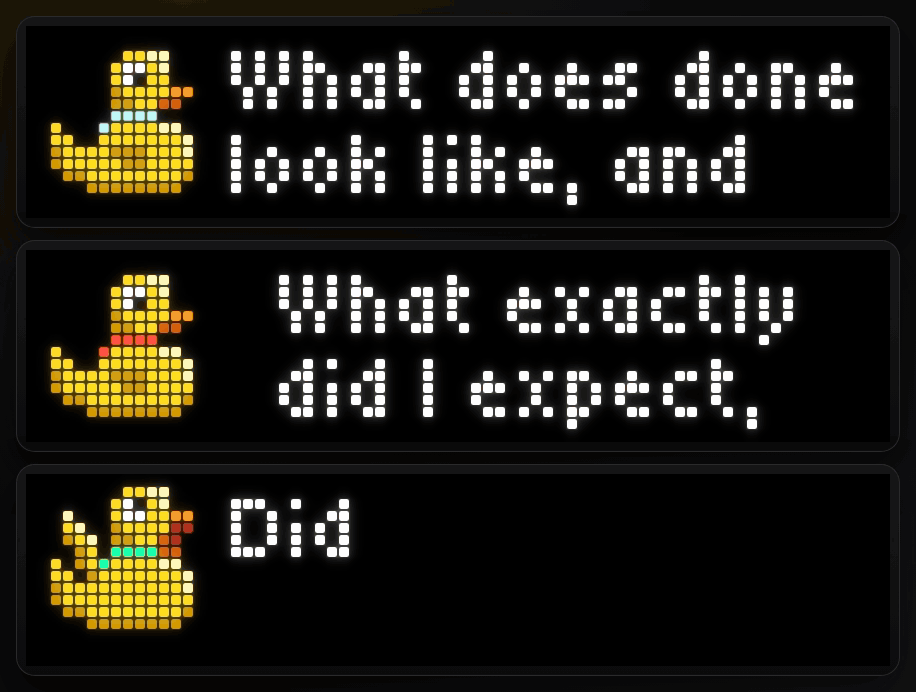

# Rubber Duck

I still reach for the duck when my agents and I get stuck. One good question can get us to say out loud what we’ve been assuming.

*1. A deck for each moment of work · 2. Start asks the next question · 3. OK explains why, and what to do*

An animated rubber duck that asks a pointed question while you work with AI coding agents. Use it to clarify a brief, get unstuck or check a change before approving it.

- Choose from 14 decks covering briefs, review, verification, debugging, retrospective questions and applied AI.
- Press Start for the next question or OK for its explanation and a concrete next step.
- The duck reads the question in short phrases on the front. The back shows the deck, reading position and controls.
- Adjust the reading pace and how often the duck quacks. Each deck remembers your place.

## In more detail

A rubber duck that asks one written question for the moment you are in with an AI coding agent, and then says why it matters. There are 14 decks and 123 questions: ten for the work itself (brief, wait, loop, review, verify, after, context, scope, debug, mind) and four from the author's notes on applied AI (evals, failures, guards, loops). A new question appears word by word while the duck's beak moves; at rest the duck only blinks.

## Controls

- Wheel: the deck.
- Start: the next question.
- OK: why it matters, and back to the question.
- Back: from the explanation to the question, otherwise leave.

## Screens, settings and sound

The back shows the deck, the place in it, the whole question and its explanation. Settings: sounds, a quack on every phrase or once per question, and the reading pace. Each deck remembers your place. The duck does not read code, call a model or judge answers.

The picture above is the app's own front screen, 72 by 16 LEDs, recorded in a simulator and drawn as LEDs: a render, not a photograph of the bar.
