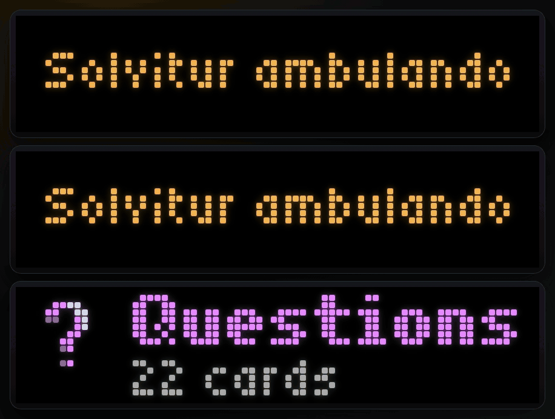

# Oracle

I liked the idea of a desk ritual that starts with one card. A good question or an old saying can send my train of thought somewhere new.

*1. Today's card and its meaning · 2. Press to draw another card · 3. Seven decks on the wheel*

A daily card for your desk, with a line to think about when you want a change of perspective. Each deck opens on its card of the day, and OK or Start draws another.

- Browse seven decks: Latin sayings, Stoic thoughts, TRIZ principles, builder maxims, engineering laws, reflective questions and applied AI.
- Cards unfold across the front screen in short pages. The back shows the fuller text, source and controls.
- Choose your reading pace and sound settings. Daily cards and the last selected deck are kept in the app’s local storage.

## In more detail

One card for the desk. Seven decks hold 217 cards: Latin sayings, Stoic thoughts, TRIZ principles, builder maxims, engineering laws, questions, and the author's notes on applied AI. Every deck opens on its card of the day; a drawn card decodes out of noise glyphs and unfolds in pages of two lines, the title first and then its meaning.

## Controls

- Wheel: the first turn opens the deck list, further turns choose a deck.
- OK or Start: draw another card.
- Back: the deck list, then leave.

## Screens, settings and sound

The back shows the full text and its source. Turning the wheel through the decks plays a small scale on a wooden mallet. Settings: sounds, an automatic draw every 5, 15 or 60 minutes, and the reading pace.

The picture above is the app's own front screen, 72 by 16 LEDs, recorded in a simulator and drawn as LEDs: a render, not a photograph of the bar.
