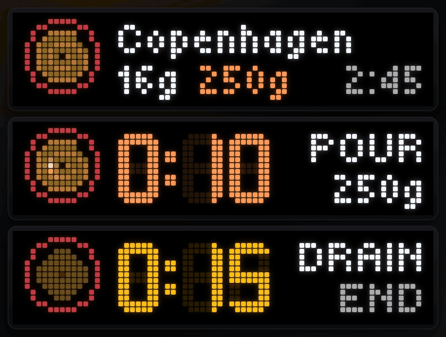

# Pour Over

I like making coffee. I wanted something on the counter that could keep time and show me the next pour while I’m holding the kettle.

*1. Choose a recipe and a dose · 2. Each step has its picture and cue · 3. Drawdown, then enjoy*

A brew timer for V60 and Kalita Wave. Choose a recipe and coffee dose, then follow timed steps and cumulative scale targets.

- Choose from 11 presets, including the Coffee Collective Kalita guide, V60 techniques, five 4:6 variants and an iced flash brew.
- Adjust the dose from 10 to 40 g. Water and ice targets scale with the dose.
- Follow animated pour paths, bloom, swirl and drawdown cues. Pause when you need a moment, or use OK to advance a step.
- The back shows the recipe, grind, water temperature and progress. Countdown sounds, light cues and temperature units are configurable.

## In more detail

A brew timer for the V60 and the Kalita Wave. Choose one of 11 recipes (the Coffee Collective Kalita guide, two by James Hoffmann, five variants of Tetsu Kasuya's 4:6 method, Scott Rao, Matt Winton and an iced flash brew) and a dose from 10 to 40 g; the scale targets follow the dose while the times stay fixed. The front shows the dripper from above with the path to pour along (circles, a spiral or the centre), a countdown for the step, and the cumulative target for the scale. Digits are copper while you pour, amber while you wait and white for the last seconds of a pour.

## Controls

- Wheel: the recipe; on the dose screen, the dose.
- OK: the dose screen, then start. While brewing: skip to the next step.
- Start: start at once. While brewing: pause and resume, for a late kettle or taring the scale.
- Back: end the brew with a summary, then the recipes, then leave.

## Screens, settings and sound

The back shows the recipe card (dose, water, temperature, grind), the full instruction, the next step, and actual against planned time at the end. A pour cue, three ticks before a pour closes and a reversed cue for “stop pouring” can be switched off; temperature reads in Celsius or Fahrenheit. It reads no scale or thermometer: the presets are timer adaptations of published methods.

The picture above is the app's own front screen, 72 by 16 LEDs, recorded in a simulator and drawn as LEDs: a render, not a photograph of the bar.
