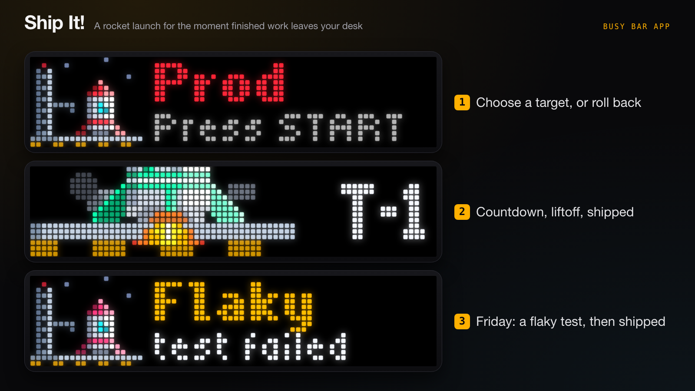

# Ship It!

I wanted a small way to mark the moment a piece of work leaves my desk. A rocket launch felt like a good reason to look up and enjoy being done.

[Watch the animated preview](preview/screens.gif)

Celebrate finishing work with a miniature rocket launch. Pick a simulated deployment target, press Start and watch the countdown, ignition and liftoff.

- Choose Dev, Staging, Canary, Prod, Hotfix, Rollback or Friday. Launch risks can be switched off in Settings.
- Watch the canary roll out in stages. Abort during the countdown or rollout, or choose Rollback to land your last launch.
- The back shows a simulated deployment log, launch history, shipped-build counts and daily streaks.
- Countdown sounds and status-light cues are optional.

## In more detail

A launch button for finished work. Pick a target, press Start and watch a three-second countdown in close-ups, ignition, liftoff with the altitude climbing, and the result. Seven targets: Dev always ships; Staging and Prod can be scrubbed by a flaky test; Canary rolls out in steps of 5, 25, 50, 75 and 100%; Hotfix; Rollback lands the last release back on the pad; and Friday fails one launch in three.

## Controls

- Wheel: the target.
- Start or OK: launch, or launch again from a result.
- During the countdown or a rollout, any button aborts; during liftoff it skips to the result.
- Back: to the pad, then leave.

## Screens, settings and sound

The back is a deploy console with the launch log, the last five launches, the shipped count and the daily streak. Launch risks, sounds and the status light can be switched off. Nothing is deployed anywhere: every line of the log is fiction.

The previews show the app's front display, recorded in a simulator and rendered as LEDs.
