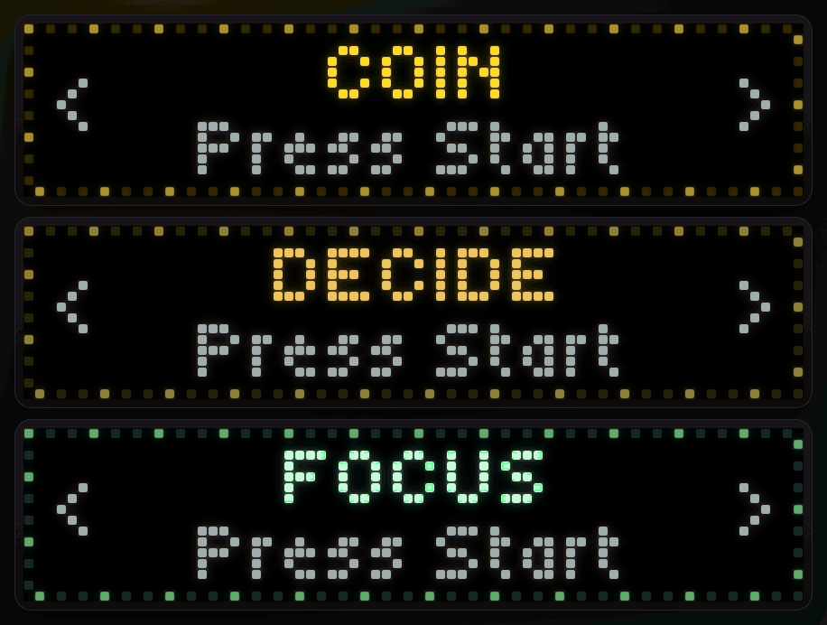

# Decision Wheel

Some decisions take longer to talk through than to try. I wanted a quick way to pick lunch, choose a break or decide what to tackle first.

*1. Coin, dice and who pays · 2. Decide: yes, no, ship it · 3. Focus, coffee and lunch decks*

Make a small decision with a colorful spinning reel. Choose a deck, spin it and see the result settle beneath the pointer.

- Choose from ten decks, including yes or no, a coin toss, a die roll, break ideas, focus tasks, coffee and lunch.
- Press OK or Start to spin. Press Back during a spin to cancel it.
- The back shows the options, odds where a deck is weighted and recent results. The app remembers the last result for each deck.
- Set the reel ticks, result sounds and light cues to your liking.

## In more detail

A slot reel for small decisions. Ten decks: Decide (yes, no, not yet, sleep on it, try small, ask, ship it), Yes / No, Coin, Dice, Who pays, Move, Break, Focus, Coffee and Lunch. The outcome is drawn once when the spin starts, and the reel slows, overshoots a little and settles on it; the result then rests in the largest letters that fit.

## Controls

- Wheel: the deck.
- OK or Start: spin.
- Back: cancel a spin without recording it, then the deck list, then leave.

## Screens, settings and sound

The back shows the options, the odds where a deck is weighted (in Decide, yes and no count double), a tally and recent results. The app remembers the last result of every deck. Reel ticks, the result sound and the status light are settings.

The picture above is the app's own front screen, 72 by 16 LEDs, recorded in a simulator and drawn as LEDs: a render, not a photograph of the bar.
